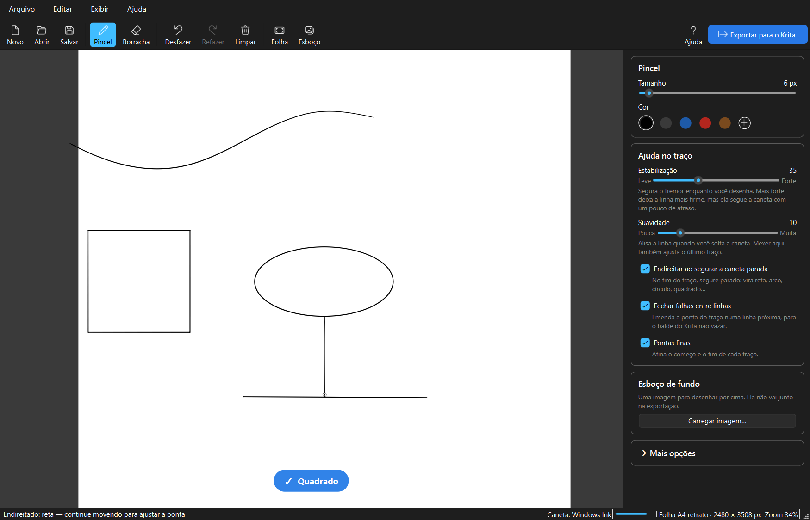
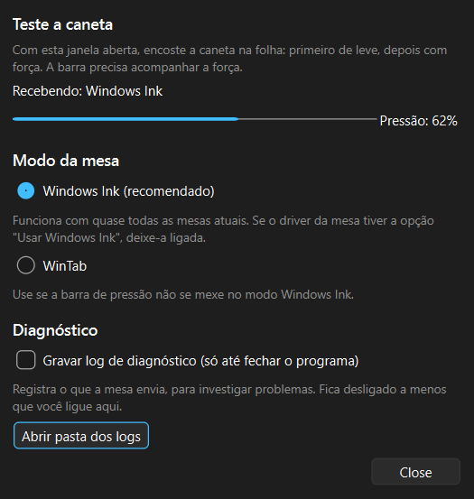

# Traço Firme

Aplicativo de lineart para mesa digitalizadora no Windows. Ele segura o tremor da mão,
endireita formas (um quadrado torto vira quadrado) e exporta as linhas para colorir no
[Krita](https://krita.org).



## O que ele faz

| Problema | Como o Traço Firme resolve |
|---|---|
| Linha tremida enquanto desenha | **Estabilização**: um filtro que se adapta à velocidade da mão, junto com uma "corda" que só deixa o traço andar quando a caneta se afasta, segura o tremor ao vivo. |
| Ondulação que sobra no traço | **Suavidade**: ao soltar a caneta, o traço é alisado e transformado em curvas suaves, sem arredondar quinas. Mexer na suavidade também ajusta o último traço feito. |
| Retas e formas tortas | **Segurar parado**: no fim do traço, segure a caneta sem levantar e ele vira reta, arco, círculo, elipse, triângulo, retângulo, quadrado ou polígono. Lados quase horizontais ou verticais ficam exatos. |
| Balde de tinta do Krita vazando | **Fechar falhas**: a ponta de um traço que termina perto de outra linha é emendada nela. |
| Linhas "duras" | **Pontas finas** e pressão da caneta com curva ajustável. |

Também tem: borracha que apaga só o trecho tocado, desfazer e refazer ilimitados, esboço
de fundo para desenhar por cima, girar e aproximar a folha, folha em tamanhos prontos (A4,
A5…) e projeto salvo em `.traco`.

## Requisitos

- Windows 10 ou 11
- [Python](https://www.python.org/downloads/) 3.10 ou mais novo (marque "Add python.exe to
  PATH" na instalação)
- Uma mesa digitalizadora com driver Windows Ink (quase todas as atuais) ou WinTab

## Instalação e uso

1. Baixe o projeto (botão **Code → Download ZIP** no GitHub, ou `git clone`).
2. Dê dois cliques em **`run.bat`**. Na primeira vez ele prepara o ambiente e instala as
   dependências, o que leva cerca de 1 minuto. Depois disso, abre direto.
3. Na primeira abertura aparece um **guia rápido**. Ele fica sempre disponível em
   **Ajuda** (F1).

Para conferir se a pressão da caneta está funcionando: **Ajuda → Mesa digitalizadora…**.
Com essa janela aberta, encoste a caneta na folha; a barra de pressão deve acompanhar a força.



## Levando para o Krita

Clique em **Exportar para o Krita** (Ctrl+E). Saem dois arquivos com o mesmo nome:

- **`nome.png`**: as linhas com fundo transparente, no tamanho da folha e com o DPI gravado.
  Abra no Krita (ou use *Camada → Importar*) e pinte numa camada por baixo.
- **`nome.svg`**: as mesmas linhas em vetor (curvas Bézier). No Krita, *Camada →
  Importar/Exportar → Importar camada…* cria uma camada vetorial editável que encaixa
  exatamente sobre o PNG, desde que o documento do Krita tenha o mesmo DPI (300 por padrão).

## Atalhos

| Tecla | Ação |
|---|---|
| B / E | Pincel / borracha (virar a caneta também apaga) |
| [ / ] | Diminuir / aumentar a ferramenta |
| Shift (desenhando) | Reta; com Ctrl+Shift, o ângulo trava de 15 em 15° |
| Espaço + arrastar, botão lateral da caneta, botão do meio | Mover a folha |
| Roda do mouse, + / − | Aproximar / afastar |
| 4 / 6 / 5 | Girar a folha / desfazer o giro |
| Ctrl+0 | Enquadrar a folha |
| Ctrl+Z / Ctrl+Y | Desfazer / refazer |
| Ctrl+N / Ctrl+O / Ctrl+S | Novo / abrir / salvar projeto |
| Ctrl+E | Exportar para o Krita |
| F1 | Guia rápido |

## Problemas comuns

- **A pressão não muda** (a barra fica parada ou a origem aparece como "Mouse"): em
  *Ajuda → Mesa digitalizadora…*, troque para **WinTab**. Se o driver da mesa tiver a opção
  "Usar Windows Ink", deixe-a ligada para o modo Windows Ink.
- **Segurar parado não endireita**: o anel azul em volta da ponta precisa completar antes
  de você soltar (cerca de 0,5 s, ajustável em *Mais opções*). Se ele ficar vermelho, a forma
  não foi reconhecida. A opção *Endireitar ao segurar a caneta parada* precisa estar ligada.
- **Algo estranho com a mesa**: em *Ajuda → Mesa digitalizadora…*, ligue **Gravar log de
  diagnóstico**, reproduza o problema e envie o arquivo `.jsonl` mais recente de
  `%LOCALAPPDATA%\TracoFirme\logs\`. O log fica desligado por padrão e só grava até o
  programa ser fechado.

## Para desenvolvedores

```bat
python -m venv .venv
.venv\Scripts\pip install -r requirements.txt -r requirements-dev.txt
.venv\Scripts\python -m tracofirme      :: abre o app
.venv\Scripts\python -m pytest          :: roda os testes
```

- [docs/ARQUITETURA.md](docs/ARQUITETURA.md): como o app funciona por dentro (módulos,
  pipeline do traço, algoritmos e decisões)
- [CONTRIBUTING.md](CONTRIBUTING.md): como contribuir
- [CHANGELOG.md](CHANGELOG.md): histórico de versões

## Licença

[MIT](LICENSE): pode usar, copiar, modificar e distribuir, inclusive comercialmente, desde que
mantenha o aviso de copyright.
